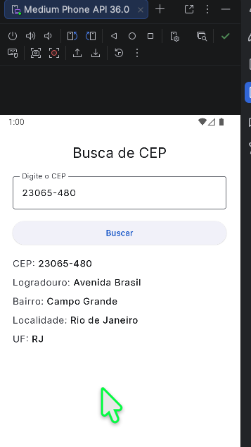
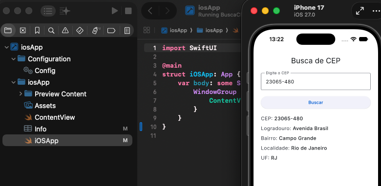
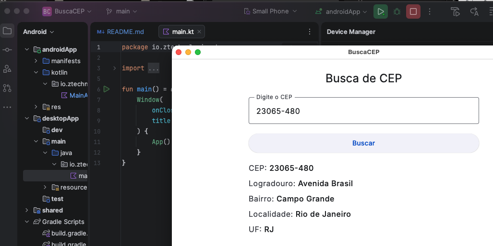
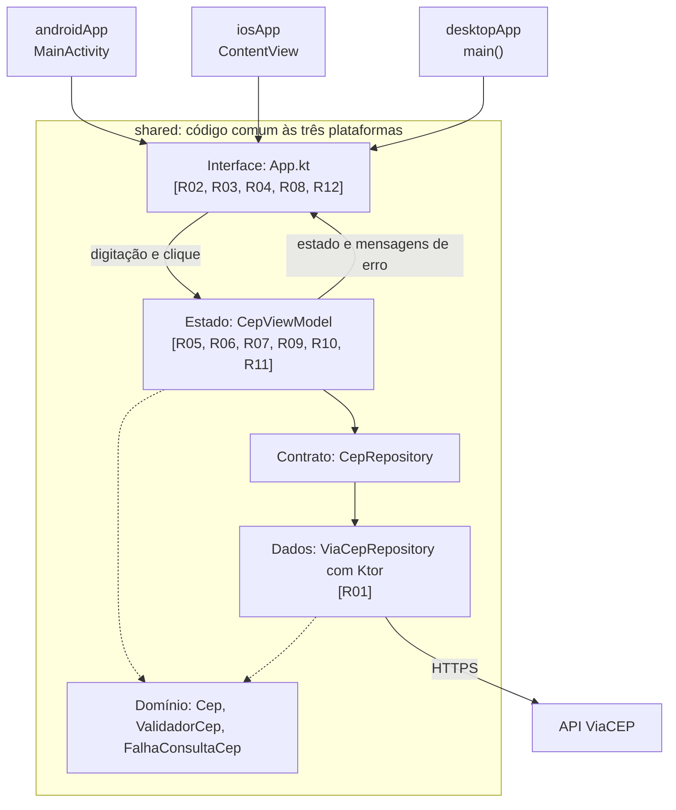
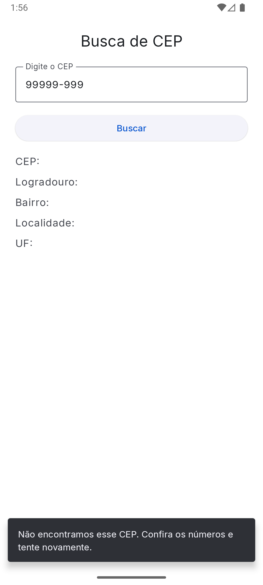
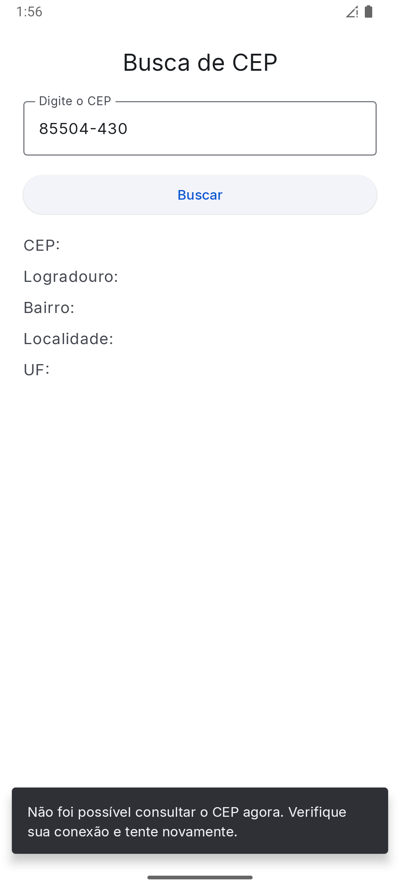

# BuscaCEP

O BuscaCEP é um aplicativo simples: você digita um CEP, toca em "Buscar" e recebe o endereço correspondente, consultado na API pública do [ViaCEP](https://viacep.com.br). A graça do projeto está em como ele foi feito. Com **Kotlin Multiplatform** e **Compose Multiplatform**, uma única base de código entrega a mesma tela e as mesmas regras no **Android**, no **iOS** e no **Desktop**.

Este é o trabalho final da disciplina *Arquiteturas e Padrões Modernos para Desenvolvimento para Dispositivos Móveis (KMP)*. Ao longo deste README, cada decisão é ligada ao critério de avaliação que ela atende.

## O aplicativo em funcionamento

As três capturas mostram a mesma consulta, o CEP `23065-480`, em cada plataforma. Repare que a tela é igual nas três: ela vem do mesmo código Compose.

| Android | iOS | Desktop |
| --- | --- | --- |
|  |  |  |
| Emulador Medium Phone (API 36) | Simulador iPhone 17 (iOS 27.0) | Janela nativa no macOS |

## O que é Kotlin Multiplatform

O [Kotlin Multiplatform (KMP)](https://kotlinlang.org/docs/multiplatform/kmp-overview.html) é uma tecnologia de código aberto da JetBrains para compartilhar código Kotlin entre plataformas, sem abrir mão das vantagens do desenvolvimento nativo. O compartilhamento é flexível: dá para dividir só um módulo, como a camada de rede, toda a lógica de negócio ou também a interface. No iOS, o Kotlin/Native gera binários nativos com acesso direto às APIs da plataforma.

O [Compose Multiplatform](https://kotlinlang.org/compose-multiplatform/) completa esse modelo na parte visual. É um framework de UI declarativo, com APIs semelhantes às do Jetpack Compose, que roda sobre o KMP.

Neste projeto, escolhi o nível mais alto de compartilhamento: interface, regras e acesso à API ficam no módulo `shared`. O que muda em cada plataforma é pouco:

- o ponto de entrada de cada aplicativo (`MainActivity`, `main()` e `ContentView`);
- o engine HTTP usado pelo Ktor (OkHttp, Darwin ou CIO).

O KMP também oferece o mecanismo [`expect`/`actual`](https://kotlinlang.org/docs/multiplatform/multiplatform-expect-actual.html) para quando o código comum precisa de uma implementação diferente por plataforma. A busca de CEP não precisou dele. O único uso no projeto é o `Platform.kt`, herdado do modelo gerado pelo Wizard, e a tela não depende dele.

Para se aprofundar: [como um projeto KMP é organizado](https://kotlinlang.org/docs/multiplatform/multiplatform-discover-project.html), [primeiros passos com KMP](https://kotlinlang.org/docs/multiplatform/get-started.html) e [Ktor Client em projetos multiplataforma](https://ktor.io/docs/client-create-multiplatform-application.html).

## Como o projeto se organiza

O fluxo abaixo acompanha uma consulta, da tela até o ViaCEP. Os códigos entre colchetes indicam os critérios de avaliação atendidos em cada etapa.



As setas contínuas mostram o caminho da consulta. As tracejadas indicam que as duas camadas usam os modelos e as regras do domínio, que não conhece nem a tela nem o HTTP.

## Critérios de avaliação

O enunciado organiza a avaliação em três blocos. Abaixo, comento como cada um foi atendido. A correspondência completa com arquivos e testes está em [docs/CRITERIOS_AVALIACAO.md](docs/CRITERIOS_AVALIACAO.md), e os itens R01 a R12 vêm de lá.

### Componentes da interface

*Tela única com campo de texto (`OutlinedTextField`), botão elevado (`ElevatedButton`) e cinco rótulos (`Text`) para os dados do endereço.*

Todo o aplicativo cabe em uma tela, sem navegação. O campo aceita apenas dígitos e mostra a máscara `00000-000`, enquanto o estado guarda os oito números puros. O botão só libera a busca quando o CEP está completo. Os cinco rótulos (CEP, Logradouro, Bairro, Localidade e UF) ficam sempre visíveis, e os valores aparecem depois da consulta.

| Item | Requisito | Onde olhar |
| --- | --- | --- |
| R02 | `OutlinedTextField` para o CEP | `App.kt`, em `TelaBuscaCep` |
| R03 | `ElevatedButton` desabilitado com CEP inválido | `App.kt` e `presentation/CepUiState.kt` |
| R04 | Cinco `Text` de resultado | `App.kt`, em `ResultadoBusca` |

### Regras de negócio e estados da UI

*Desabilitar os inputs durante a requisição, exibir o indicador circular de progresso dentro do botão e tratar falhas via Snackbar.*

Quando a busca começa, os resultados anteriores somem, o campo e o botão são desabilitados e o `CircularProgressIndicator` assume o lugar do texto "Buscar". Como esse estado muda de forma síncrona, um clique repetido não gera uma segunda requisição. No fim da consulta, com sucesso ou falha, os controles voltam ao normal.

Se algo der errado, o usuário vê uma `Snackbar` com uma mensagem clara, sem detalhes técnicos. Há textos próprios para CEP inexistente, falta de conexão ou tempo esgotado e resposta inesperada do serviço. A mensagem sai por um fluxo de eventos, então não reaparece quando a tela é recriada, por exemplo ao girar o aparelho.

As capturas abaixo mostram dois erros reais no emulador Android. Nos dois casos, os resultados ficam vazios e o campo e o botão voltam a ficar habilitados.

| CEP inexistente (`99999-999`) | Sem conexão com a internet |
| --- | --- |
|  |  |

| Item | Requisito | Onde olhar |
| --- | --- | --- |
| R06 | Limpar os cinco textos ao iniciar a consulta | `CepViewModel.buscar()` |
| R07 | Campo desabilitado durante a consulta | `CepUiState.campoHabilitado` e `App.kt` |
| R08 | Botão desabilitado com `CircularProgressIndicator` dentro dele | Conteúdo do `ElevatedButton` em `App.kt` |
| R09 | Exibir os cinco campos no sucesso | `CepViewModel.buscar()` e `ResultadoBusca` |
| R10 | Reabilitar o campo ao concluir | `carregando = false` no sucesso e na falha |
| R11 | Reabilitar o botão e restaurar o texto | `CepUiState.botaoHabilitado` e `App.kt` |
| R12 | Informar erros por `Snackbar` | `CepViewModel.mensagensErro`, `App.kt` e `presentation/MensagensErro.kt` |

### Arquitetura e consumo de API

*Reutilização das camadas de dados e domínio, controle de estado via ViewModel e requisição ao ViaCEP com o Ktor Client.*

O código se divide em três camadas com responsabilidades bem separadas. O `domain/` guarda o modelo de endereço, a validação e os tipos de falha. O `data/` conversa com o ViaCEP e traduz qualquer problema técnico para essas falhas. O `presentation/` guarda a `CepViewModel`, que controla o estado e expõe tudo à tela por `StateFlow`.

A ViewModel conhece apenas a interface `CepRepository`. Foi essa escolha que permitiu testá-la com um repositório falso, sem internet. O Ktor Client faz a requisição, com tempo limite de 10 s para a conexão e de 15 s para a consulta completa.

| Item | Requisito | Onde olhar |
| --- | --- | --- |
| R01 | Cliente HTTP multiplataforma (Ktor) consultando o ViaCEP | `data/ViaCepRepository.kt`, `data/ViaCepDto.kt` e `shared/build.gradle.kts` |
| R05 | `ViewModel` gerenciando o estado e a chamada à API | `presentation/CepViewModel.kt` |

### Como os critérios foram verificados

A lógica é coberta por testes automatizados em `shared/src/commonTest`, executados no Desktop/JVM, no Android e no iOS. Esses testes não exercitam os componentes visuais. Por isso, a parte de interface foi conferida executando o aplicativo, como registrado na [conferência manual](docs/CRITERIOS_AVALIACAO.md#conferência-manual-versão-110) e nas capturas acima.

## Controle de versão

| Versão | Data | Commit | Descrição |
| --- | --- | --- | --- |
| 1.0.0 | 30/10/2026 | `64574c0` | Busca de CEP com ViaCEP para Android, Desktop e iOS |
| 1.1.0 | 30/10/2026 | `80422bd` | Tema claro/escuro com contraste WCAG AA, fonte Inter e leiaute alinhado às figuras do enunciado |

A versão do aplicativo também está em `androidApp/build.gradle.kts` (`versionName`), `desktopApp/build.gradle.kts` (`packageVersion`) e `iosApp/Configuration/Config.xcconfig` (`MARKETING_VERSION`). Para conferir o commit da cópia local, use `git log -1 --format="%h %ad" --date=short`.

## Funcionalidades

- Campo `OutlinedTextField` que aceita apenas dígitos (até oito) e exibe a máscara `00000-000`.
- Botão `ElevatedButton` "Buscar", habilitado somente quando há oito dígitos e nenhuma consulta em andamento.
- Durante a consulta: os resultados anteriores são limpos, o campo e o botão ficam desabilitados e um `CircularProgressIndicator` aparece dentro do botão.
- Ao concluir: cinco `Text` exibem CEP, logradouro, bairro, localidade e UF; campo e botão voltam a ficar habilitados.
- Em caso de erro (CEP inexistente, falha de rede, tempo esgotado ou resposta inesperada), uma `Snackbar` informa o usuário.
- Fundo branco nas três plataformas, mesmo com o sistema em modo escuro, e tipografia Inter (detalhes em [Interface e acessibilidade](#interface-e-acessibilidade)).

## Pré-requisitos

- Android Studio com suporte a Kotlin Multiplatform.
- JDK 17 ou superior para executar o Gradle (o código é compilado com alvo JVM 11).
- Android SDK com a plataforma 37 (`compileSdk`/`targetSdk` 37, `minSdk` 27).
- Para iOS: **macOS com Xcode**. O build nativo iOS não é possível em Windows ou Linux.

Principais versões (definidas em `gradle/libs.versions.toml`): Kotlin 2.4.21, Compose Multiplatform 1.12.2, AGP 9.1.1, Gradle 9.5.1, Ktor 3.6.1, kotlinx-coroutines 1.11.0, Lifecycle 2.11.0.

## Estrutura dos módulos

```text
BuscaCEPZaroni/
├── shared/       Módulo KMP com a UI Compose e toda a lógica (Android, JVM e iOS)
├── androidApp/   Aplicativo Android: MainActivity chama App()
├── desktopApp/   Aplicativo Desktop: main() abre uma Window com App()
└── iosApp/       Projeto Xcode: ContentView exibe MainViewController() do framework Shared
```

Código compartilhado em `shared/src/commonMain/kotlin/io/ztechnologies/buscacep/`:

```text
App.kt                          Tela Compose (campo, botão, resultados e Snackbar)
domain/
  Cep.kt                        Modelo de endereço, independente de HTTP
  ValidadorCep.kt               Normalização e validação dos oito dígitos
  FalhaConsultaCep.kt           Tipos de falha: não encontrado, sem conexão, resposta inesperada
data/
  CepRepository.kt              Contrato de consulta (permite usar um fake nos testes)
  ViaCepRepository.kt           Cliente Ktor do ViaCEP, timeouts e tradução de erros
  ViaCepDto.kt                  Formato JSON da resposta do ViaCEP
presentation/
  CepUiState.kt                 Estado imutável da tela
  CepViewModel.kt               Validação, consulta, carregamento e eventos de erro
  MensagensErro.kt              Mensagens exibidas ao usuário
  MascaraCep.kt                 Máscara visual 00000-000
  TemaBuscaCep.kt               Cores (fundo branco) e tipografia Inter
composeResources/font/          Arquivos da fonte Inter (Regular, Medium e SemiBold)
```

## Arquitetura

O fluxo visual está em [Como o projeto se organiza](#como-o-projeto-se-organiza). Os detalhes de cada parte:

- **`CepViewModel`** (Lifecycle Multiplatform) expõe o estado como `StateFlow<CepUiState>` e mantém o `MutableStateFlow` privado. Ao buscar, marca `carregando = true` e apaga o resultado anterior de forma síncrona; por isso cliques repetidos não disparam requisições duplicadas.
- **Erros** saem por um `Channel` exposto como `Flow<String>`. Cada mensagem é entregue uma única vez, então a Snackbar não reaparece após recomposição ou rotação de tela.
- **`ViaCepRepository`** usa um único `HttpClient`, criado junto com a ViewModel e fechado em `onCleared` por meio de `addCloseable`. Timeouts: 10 s para conexão e 15 s para a requisição. O `CancellationException` é sempre propagado, nunca convertido em erro de negócio.
- **Engine HTTP por plataforma**: OkHttp no Android, CIO no Desktop e Darwin no iOS. Cada um é dependência do source set correspondente e o Ktor o seleciona automaticamente.
- **Resposta do ViaCEP**: campos extras são ignorados (`ignoreUnknownKeys`), campos ausentes viram texto vazio e o indicador de CEP inexistente é aceito tanto como `"erro": true` quanto como `"erro": "true"`.

## Interface e acessibilidade

O leiaute segue as figuras do enunciado: campo "Digite o CEP", botão "Buscar" com a largura do campo e os cinco resultados logo abaixo. As escolhas visuais seguem as recomendações do Material Design (Google) e do Human Interface Guidelines (Apple):

- **Cores**: esquema Material 3 próprio, em azul, com fundo sempre branco, independentemente do modo do sistema. Todos os textos têm contraste mínimo de 4,5:1 com o fundo e a borda do campo tem pelo menos 3:1 (nível AA da WCAG 2.1). Exemplos: texto principal 17,1:1; texto do botão 5,8:1.
- **Estado desabilitado**: mantém a opacidade reduzida padrão do Material, que sinaliza que o controle não está disponível.
- **Tipografia**: fonte [Inter](https://rsms.me/inter/), desenhada para leitura em tela, embutida como recurso Compose para ter a mesma aparência no Android, no iOS e no Desktop. Os tamanhos seguem a escala do Material 3 em `sp`, respeitando o tamanho de texto configurado pelo usuário. A fonte é distribuída sob a SIL Open Font License 1.1; o texto da licença está em [licencas/Inter-OFL.txt](licencas/Inter-OFL.txt).
- **Resultados**: o rótulo aparece em cor secundária e o valor em destaque, para que o dado consultado seja lido primeiro.

## Como executar

### Tudo de uma vez (macOS)

O script `runall.sh`, na raiz do projeto, compila e abre as três versões: Android no emulador, iOS no simulador e Desktop por último.

```bash
./runall.sh                  # as três versões
./runall.sh android ios      # apenas as versões indicadas
```

### Android

No Android Studio, selecione a configuração **androidApp** e execute em um emulador ou aparelho. Pela linha de comando:

```bash
./gradlew :androidApp:assembleDebug        # Windows: gradlew.bat :androidApp:assembleDebug
./gradlew :androidApp:installDebug         # instala no aparelho/emulador conectado
```

A permissão `android.permission.INTERNET` está declarada em `androidApp/src/main/AndroidManifest.xml`. Todo o tráfego é HTTPS.

### Desktop

```bash
./gradlew :desktopApp:run                  # Windows: gradlew.bat :desktopApp:run
```

### iOS (requer macOS com Xcode)

1. Abra `iosApp/iosApp.xcodeproj` no Xcode.
2. Em *Signing & Capabilities*, escolha seu time de desenvolvimento caso vá rodar em um iPhone físico. No simulador não é necessário.
3. Selecione um simulador (ou aparelho) e clique em **Run**. A fase de build do Xcode compila o framework `Shared` via Gradle.

Os targets configurados são `iosArm64` (aparelho) e `iosSimulatorArm64` (simulador em Macs com Apple Silicon). A interface exibida é a mesma `App()` Compose, por meio de `MainViewController()`; não há tela duplicada em SwiftUI. Como o ViaCEP usa HTTPS, nenhuma exceção de ATS é necessária no `Info.plist`.

## Testes

Os testes ficam em `shared/src/commonTest` e não acessam a internet: a ViewModel usa um repositório falso controlado pelo teste e o repositório usa o `MockEngine` do Ktor.

```bash
./gradlew :shared:jvmTest                  # Desktop/JVM
./gradlew :shared:testAndroidHostTest      # Android (JVM local)
./gradlew :shared:iosSimulatorArm64Test    # iOS (somente no macOS)
```

| Arquivo | O que cobre |
| --- | --- |
| `CepValidationTest` | CEP vazio/incompleto, oito dígitos, caracteres não numéricos, limite de oito dígitos |
| `CepViewModelTest` | Estado durante a consulta, sucesso, limpeza do resultado anterior, CEP inexistente, falha de rede, cliques repetidos |
| `ViaCepRepositoryTest` | Conversão do JSON, campos extras e ausentes, `erro` booleano e texto, status HTTP de erro, corpo inválido, falha de rede |

## Preparando a entrega

Antes de compactar o projeto para o Moodle:

```bash
./gradlew clean                            # Windows: gradlew.bat clean
```

Depois, **não inclua** no arquivo: `build/` (de todos os módulos), `.gradle/`, `.kotlin/`, `.idea/`, `local.properties`, `iosApp/build/`, `xcuserdata/` nem `*.iml`.

## Limitações

- O target `iosX64` (simulador em Macs Intel) não está habilitado, como no projeto gerado pelo Wizard. Se necessário, adicione `iosX64()` à lista de targets em `shared/build.gradle.kts`.
